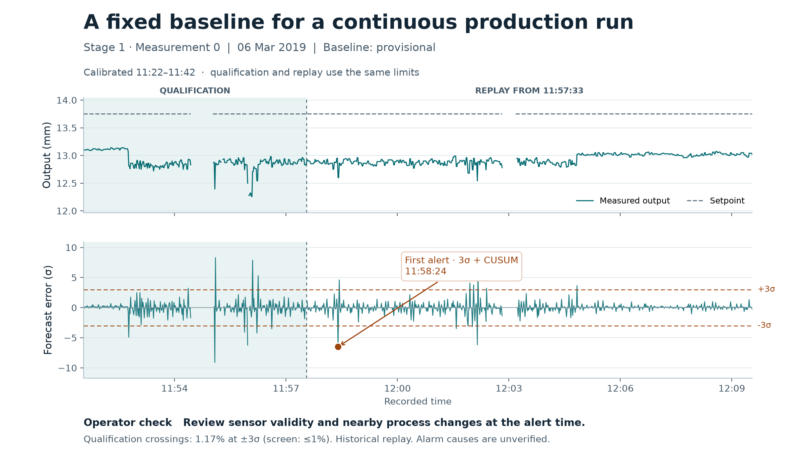

# Statistical process control for continuous manufacturing

An offline statistical process control (SPC) case study using 14,088 timestamped records from a two-stage production line. The notebook follows the same measurement location at each stage and shows how to qualify historical control limits, investigate a replay alert, and benchmark the detector on known shifts.

## Run the notebook

Install the dependencies and open JupyterLab from this project folder.

~~~sh
python -m pip install jupyterlab numpy pandas matplotlib
python -m jupyterlab
~~~

Open `statistical_process_control.ipynb` and run all cells. The notebook uses the local CSV in `src/` and regenerates `spc_replay.png`.

## What the replay does

- Charts actual output measurements and displays setpoints as targets. It keeps the original clock, audits missing and duplicate timestamps, and skips zero-coded and invalid readings without filling the gaps.
- Fits a one-second forecast model on minutes 30–50, checks the frozen baseline on minutes 50–65, and replays the rest of the run. The first 30 minutes have limited Stage 2 coverage. The notebook compares raw and residual autocorrelation and shows any baseline checks that failed.
- Logs three-sigma and two-sided CUSUM alarms with timestamps and direction. It also checks all eight Nelson rules with known sequences and reports their diagnostic counts.
- Compares the detectors at approximately the same simulated false-alert rate. The benchmark reports detection rate and median delay for injected shifts of ±0.5σ, ±1σ, and ±2σ.

## Results

Both historical baselines are provisional. The Stage 1 forecast errors reduced the largest absolute autocorrelation across lags 1–10 from 0.947 to 0.197, but 1.17% of qualification points crossed the fixed three-sigma limits, above the 1% screening threshold. Stage 2 exceeded both the crossing-rate and residual autocorrelation thresholds. In the Stage 1 replay, the first alert fired at **11:58:24** in both detectors. Sensor validity and nearby process changes are the first things to check.

| Simulated performance | Three-sigma | CUSUM |
| --- | ---: | ---: |
| In-control false alerts per hour | 9.74 | 9.81 |
| ±0.5σ shifts detected within 120 s | 51.83% | 98.57% |
| Median delay for detected ±0.5σ shifts | 50 s | 23 s |

The benchmark uses independent synthetic forecast errors at a one-second cadence. The historical data has no labeled alarm causes or defect events. Capability indices require documented specification limits and a stable process.

[Dataset published on Kaggle](https://www.kaggle.com/datasets/supergus/multistage-continuousflow-manufacturing-process) · [Published data-quality study](https://link.springer.com/article/10.1186/s40537-020-00367-w)
